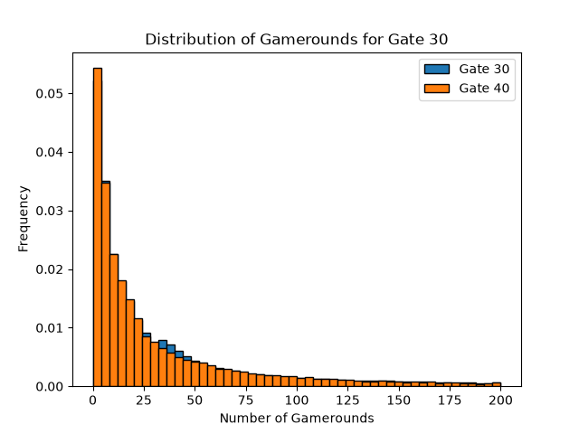
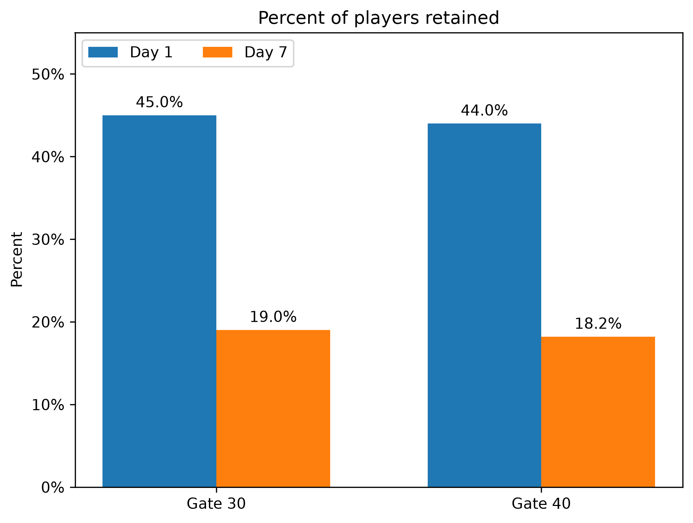
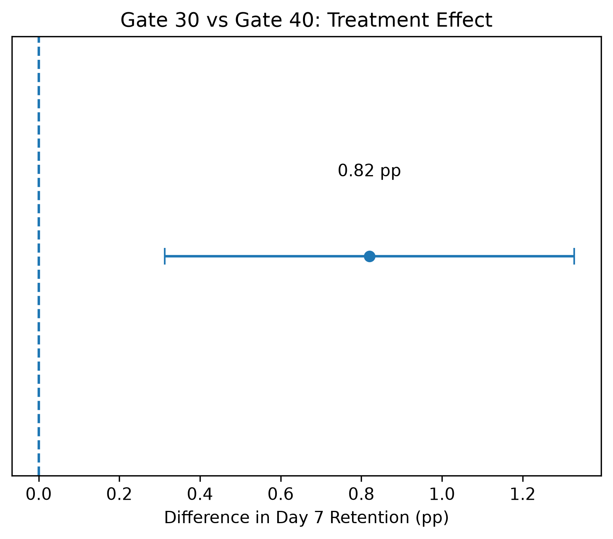

# Cookie Cats A/B Testing: Player Retention Analysis

## Project Overview
This project analyzes the results of a randomized A/B test conducted in Cookie Cats, a mobile puzzle game. The experiment evaluated whether moving a progression gate from level 30 to level 40 affected player retention and engagement.

Using SQL and Python, I explored player behavior, performed statistical hypothesis tests, investigated extreme observations, and developed a data-driven recommendation.

## Business Objective
Determine whether moving the progression gate from level 30 to level 40 improves player retention and engagement.

## Dataset
The dataset contains 90,189 players divided into two experimental groups:
- **Gate 30:** 44,700 players
- **Gate 40:** 45,489 players

The primary variables include player ID, experimental group, total game rounds, Day 1 retention, and Day 7 retention.

Dataset source: https://www.kaggle.com/datasets/yufengsui/mobile-games-ab-testing

## Tools and Technologies
- **SQL / SQLite / DBeaver:** Data exploration and aggregation
- **Python / Pandas:** Data processing
- **SciPy / Statsmodels:** Statistical hypothesis testing
- **Matplotlib:** Data visualization
# Visualizations
### Distribution of Gamerounds Comparison


### Player Retention Comparison



### 95% Confidence Interval



## Methodology
1. Explored the experimental dataset using SQL.
2. Calculated Day 1 and Day 7 retention rates.
3. Conducted a two-proportion z-test and constructed a 95% confidence interval.
4. Examined game-round distributions, mean, median, and outliers.
5. Performed Welch's t-tests and sensitivity analyses.
6. Compared 5% trimmed means using Yuen's t-test.

## Key Findings
- **Day 7 retention:** 19.02% for Gate 30 versus 18.20% for Gate 40.
- **Retention difference:** 0.82 percentage points favoring Gate 30.
- **Statistical significance:** Two-proportion z-test p-value approximately 0.00155.
- **95% confidence interval:** Approximately 0.31 to 1.33 percentage points for Gate 30 minus Gate 40.
- **Game-round engagement:** No statistically significant difference was detected by the tests conducted. One extreme observation substantially affected the ordinary mean.

## Recommendation
The results favor keeping the progression gate at level 30 due to significantly higher Day 7 retention. Additional analysis of monetization, player satisfaction, and longer-term engagement would help support a final product decision.

## How to Run This Project

1. Clone the repository.
2. Download the Cookie Cats dataset from the Kaggle link above.
3. Place `cookie_cats.csv` inside the `data/` folder.
4. Install the Python dependencies:

   ```bash
   py -3.13 -m pip install -r requirements.txt
   ```

5. Run the statistical analysis:

   ```bash
   py -3.13 python/statistical_analysis.py
   ```

6. Generate the visualizations:

   ```bash
   py -3.13 python/visualizations.py
   ```

The SQL analysis was performed using SQLite in DBeaver. Import the CSV into a table named `cookie_cats` before executing the SQL queries.
  